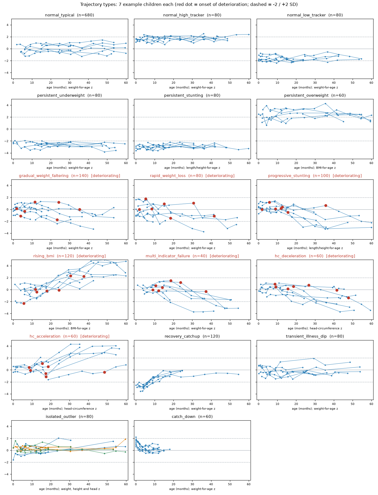
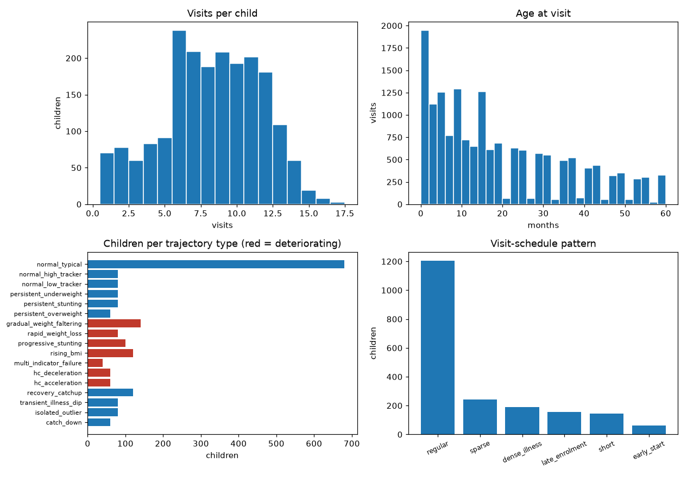

# Synthetic longitudinal growth dataset: documentation

*Generated by `scripts/make_synthetic.py --children 2000 --seed 42` (fully reproducible).*

**This is synthetic data.** It exists to develop, test and demonstrate the pipeline. It contains no real patients, the
trajectory parameters are project assumptions (not clinical facts), and any result obtained on it shows technical feasibility only,
not clinical validity.

## 1. What is in it

| item | value |
|---|---|
| children | 2000 (986 boys, 1014 girls) |
| visits | 16505 (mean 8.3 per child, range 1 to 17) |
| ages covered | 0 to 60 months (every visit is inside the 5-year project scope) |
| trajectory types | 17 (7 deteriorating, 10 not) |
| deteriorating children | 600 (30%); positive visits (at or after onset): 3022 (18.3% of visits) |
| patient codes | `S-0001` and up (the app's code generator only uses `A-####`, so real and synthetic children never clash) |
| reference date | no visit is later than 31 Oct 2026; no child has two visits on the same date; visits are at least 10 days apart |

Files: `data/synthetic_visits.csv`, `data/synthetic_children.csv`, `data/synthetic_errors.csv`, and the figures in `docs/figures/`.





## 2. How the data are produced

1. **Trajectory type per child.** The 17 types below fix how the weight, length/height and head-circumference z-scores
   evolve. Shares are exact (counts rounded to sum to 2000).
2. **Child-level size factor.** Each child gets a baseline (weight z ~ N(0, 0.8); height z and head z correlated with it) so the three
   measurements move together as they do in real children.
3. **Onset.** For deteriorating types the onset visit is chosen so there are at least 2 visits before and at least 2 visits from onset on.
   The z-scores change after the onset age; the label switches on at the onset visit.
4. **Noise.** Correlated (AR(1)) noise with a memory of 4 months and SD 0.35/0.3/0.3 (weight/height/head),
   plus independent measurement noise SD 0.12. A child therefore tends to stay near their own line instead of jumping at random.
5. **Visit schedule** (5 patterns, see section 4), including children with only 1 or 2 visits so the "insufficient longitudinal history"
   behaviour can be tested.
6. **From z-score to measurement.** The target z-score is converted to kilograms or centimetres with the inverse WHO LMS formula,
   rounded the way a clinic records it (weight 0.01 kg, length/height and head 0.1 cm), and sent back through the same WHO engine the
   app uses (`who_zscore.analyse_child`). **Every stored z-score, BMI and category is therefore exactly what the app would have saved.**
7. **Length versus standing height.** Under 2 years the length table is used and from 731 days the height table. About 8% of children aged
   12-24 months are recorded as *standing* and about 10% of children aged 2+ as *recumbent*; their recorded value is shifted by 0.7 cm so
   the engine's WHO adjustment returns the intended z-score. This exercises the recumbent/standing logic.
8. **Plausibility.** If any indicator would fall outside the WHO plausibility range (WAZ -6 to +5, HAZ -6 to +6, BMIZ and HCZ -5 to +5),
   which is also the range your app's dynamic limits accept, that visit's z-scores are scaled toward zero until it fits
   (65 visits, 0.39%). No visit in the file is outside the limits.
9. **Split.** Children (never single visits) are assigned to train / validation / test = 70/15/15, stratified by trajectory type, so every
   type appears in every split.

## 3. Trajectory types

| trajectory type | children | visits | mean visits/child | label | positive visits | what it represents |
|---|---|---|---|---|---|---|
| normal_typical | 680 | 4971 | 7.3 | not deteriorating | 0 | Tracks one centile band with small correlated noise (reference 'healthy' child). |
| normal_high_tracker | 80 | 632 | 7.9 | not deteriorating | 0 | Large but healthy: weight and height stay high (about +1.5 to +2.2) without worsening. |
| normal_low_tracker | 80 | 593 | 7.4 | not deteriorating | 0 | Small but healthy: weight and height stay low-normal (about -1.4 to -1.9). |
| persistent_underweight | 80 | 586 | 7.3 | not deteriorating | 0 | Weight stays below -2 from the first visit and does not worsen (already caught by the WHO cut-off). |
| persistent_stunting | 80 | 638 | 8.0 | not deteriorating | 0 | Length/height stays below -2 from the first visit and does not worsen. |
| persistent_overweight | 60 | 432 | 7.2 | not deteriorating | 0 | Weight high for height from the first visit; BMI z stays about +2 to +3, stable. |
| gradual_weight_faltering | 140 | 1322 | 9.4 | deteriorating | 687 | After onset, weight z falls slowly (0.08-0.20 per month, 8-20 months); height follows weakly. |
| rapid_weight_loss | 80 | 731 | 9.1 | deteriorating | 391 | After onset, weight z falls quickly (0.3-0.7 per month for 2.5-5 months) then stays low. |
| progressive_stunting | 100 | 910 | 9.1 | deteriorating | 522 | After onset, length/height z falls (0.06-0.15 per month, 12-24 months); weight and head follow weakly. |
| rising_bmi | 120 | 1102 | 9.2 | deteriorating | 595 | After onset, weight z rises (0.10-0.25 per month) with height unchanged, so BMI z climbs. |
| multi_indicator_failure | 40 | 360 | 9.0 | deteriorating | 201 | Weight falls, height follows, head circumference falls later: severe combined deterioration. |
| hc_deceleration | 60 | 569 | 9.5 | deteriorating | 318 | After onset, head-circumference z falls (0.12-0.25 per month) while other indicators are normal. |
| hc_acceleration | 60 | 585 | 9.8 | deteriorating | 308 | After onset, head-circumference z rises (0.12-0.25 per month) while other indicators are normal. |
| recovery_catchup | 120 | 1095 | 9.1 | not deteriorating | 0 | Starts low (about -2.2 to -3.0) then catches up towards normal: improving, must not be flagged as worsening. |
| transient_illness_dip | 80 | 768 | 9.6 | not deteriorating | 0 | A temporary weight dip of 0.8-1.4 z over 2 months that rebounds: hard negative for decline detectors. |
| isolated_outlier | 80 | 699 | 8.7 | not deteriorating | 0 | Normal child with 1-2 isolated visits shifted by 1.2-2.0 z (plausible measurement slip): robustness case. |
| catch_down | 60 | 512 | 8.5 | not deteriorating | 0 | Large at birth (+1.3 to +2.0) and drifts down to the child's own line within months: a normal falling z-score. |

Rules for the label: `label_emerging = 1` only for visits **at or after the onset visit** of a deteriorating type. Persistent low or high
children, recovering children, catch-down, transient dips and isolated outliers are **0** by design: they are either already identified by the
conventional WHO cut-off, improving, or not sustained. `transient_illness_dip` and `isolated_outlier` are intentionally *hard negatives*: during the
dip itself a model may legitimately raise an alert, so expect some false alarms there and report them in the error analysis.

## 4. Visit patterns

| pattern | children |
|---|---|
| regular | 1206 |
| sparse | 242 |
| dense_illness | 191 |
| late_enrolment | 156 |
| short | 145 |
| early_start | 60 |

- **regular**: well-child schedule 0, 1, 2, 4, 6, 9, 12, 15, 18, 24, 30, 36, 42, 48, 54, 60 months with random start, 15% of visits missed, and age jitter.
- **sparse**: 3-5 visits at random ages. **late_enrolment**: first visit at 12 months or later. **dense_illness**: regular plus 2-4 extra visits about monthly during a short window.
- **short**: 1-2 visits (only for the non-deteriorating types that allow it). **early_start**: newborn series for `catch_down`.

| visits per child | children |
|---|---|
| 1 | 70 |
| 2 | 78 |
| 3-4 | 143 |
| 5-8 | 726 |
| 9-12 | 784 |
| 13+ | 199 |

| age (months) | visits |
|---|---|
| 0-6 | 4327 |
| 6-12 | 2783 |
| 12-24 | 3904 |
| 24-36 | 2342 |
| 36-48 | 1816 |
| 48-60 | 1333 |

| age_group | measurement_type | visits |
|---|---|---|
| 2 years and over | Recumbent Length | 543 |
| 2 years and over | Standing Height | 4948 |
| under 2 years | Recumbent Length | 10684 |
| under 2 years | Standing Height | 330 |

## 5. Summary statistics

| indicator | min | median | max | visits beyond -2 (%) | visits beyond +2 (%) |
|---|---|---|---|---|---|
| weight-for-age | -4.14 | -0.19 | 4.16 | 11.2 | 4.2 |
| length/height-for-age | -4.3 | -0.18 | 2.69 | 5.3 | 0.5 |
| BMI-for-age | -5.0 | -0.13 | 4.99 | 10.3 | 6.3 |
| head circumference | -4.33 | -0.09 | 4.32 | 1.2 | 1.2 |

| split | children | visits | positive_visits |
|---|---|---|---|
| test | 300 | 2434 | 449 |
| train | 1400 | 11601 | 2125 |
| validation | 300 | 2470 | 448 |

## 6. What the conventional rule does with this data

The simplest conventional rule (any indicator beyond the WHO cut-off: weight or height z below -2, BMI or head z beyond +/-2) was applied to every visit.
This is a property of the dataset, not a model result. It shows what is already caught by the cut-off and what is left for trajectory methods.

| trajectory type | children ever flagged (%) | flagged before onset (%) | median visits from onset to first flag | never flagged (%) |
|---|---|---|---|---|
| normal_typical | 20.0 | - | - | 80.0 |
| normal_high_tracker | 61.2 | - | - | 38.8 |
| normal_low_tracker | 77.5 | - | - | 22.5 |
| persistent_underweight | 98.8 | - | - | 1.2 |
| persistent_stunting | 100.0 | - | - | 0.0 |
| persistent_overweight | 95.0 | - | - | 5.0 |
| gradual_weight_faltering | 68.6 | 15.0 | 2.0 | 31.4 |
| rapid_weight_loss | 83.8 | 21.2 | 1.0 | 16.2 |
| progressive_stunting | 53.0 | 12.0 | 3.0 | 47.0 |
| rising_bmi | 80.0 | 15.0 | 2.0 | 20.0 |
| multi_indicator_failure | 82.5 | 5.0 | 2.0 | 17.5 |
| hc_deceleration | 73.3 | 10.0 | 2.5 | 26.7 |
| hc_acceleration | 81.7 | 16.7 | 2.0 | 18.3 |
| recovery_catchup | 99.2 | - | - | 0.8 |
| transient_illness_dip | 37.5 | - | - | 62.5 |
| isolated_outlier | 62.5 | - | - | 37.5 |
| catch_down | 31.7 | - | - | 68.3 |

Read it like this: children who are flagged before their onset (or from the first visit) are chronic cases, which the cut-off already finds;
the deteriorating children whose first flag comes several visits after onset are the room an earlier-warning method has to work in.

## 7. Error-injection file (`synthetic_errors.csv`)

825 corrupted copies of real visits (5%), cycling through 16 error types. **They are not loaded
into the database.** Column `caught_by` says which defence of the app stops the record first (in the order the app applies them);
`undetected` means that nothing in the current app catches it.

| error_type | records | age_scope | date_check | duplicate_check | dynamic_who_limits | input_range | previous_visit_check | required_field | undetected |
|---|---|---|---|---|---|---|---|---|---|
| age_beyond_5_years | 5 | 5 | 0 | 0 | 0 | 0 | 0 | 0 | 0 |
| duplicate_visit_date | 44 | 0 | 0 | 44 | 0 | 0 | 0 | 0 | 0 |
| future_visit_date | 51 | 0 | 51 | 0 | 0 | 0 | 0 | 0 | 0 |
| hc_copied_from_height | 52 | 0 | 0 | 0 | 9 | 43 | 0 | 0 | 0 |
| hc_in_inches | 52 | 0 | 0 | 0 | 52 | 0 | 0 | 0 | 0 |
| height_drop_plausible | 43 | 0 | 0 | 0 | 0 | 0 | 5 | 0 | 38 |
| height_in_inches | 52 | 0 | 0 | 0 | 52 | 0 | 0 | 0 | 0 |
| height_in_mm | 52 | 0 | 0 | 0 | 0 | 52 | 0 | 0 | 0 |
| missing_head_circumference | 51 | 0 | 0 | 0 | 0 | 0 | 0 | 51 | 0 |
| visit_before_birth | 51 | 0 | 51 | 0 | 0 | 0 | 0 | 0 | 0 |
| weight_decimal_slip_down | 52 | 0 | 0 | 0 | 52 | 0 | 0 | 0 | 0 |
| weight_decimal_slip_up | 52 | 0 | 0 | 0 | 3 | 49 | 0 | 0 | 0 |
| weight_height_swapped | 52 | 0 | 0 | 0 | 4 | 48 | 0 | 0 | 0 |
| weight_in_grams | 52 | 0 | 0 | 0 | 0 | 52 | 0 | 0 | 0 |
| weight_in_pounds | 113 | 0 | 0 | 0 | 112 | 0 | 0 | 0 | 1 |
| zero_weight | 51 | 0 | 0 | 0 | 0 | 0 | 0 | 51 | 0 |

Overall: 786 of 825 are stopped (95%); 39 are not
(check the rows with `caught_by == undetected` to see which error types currently need another layer, for example a previous-visit or a cross-field check).

## 8. Data dictionary

**synthetic_visits.csv** (one row per visit; the first block matches the app's `patients` and `visits` tables)

| column | meaning |
|---|---|
| patient_code, sex, date_of_birth | child identity (`Boy` / `Girl`) |
| visit_date | date of the visit |
| weight_kg, height_cm, head_circumference_cm | recorded measurements (`height_cm` is length or standing height as recorded) |
| measurement_type | `Recumbent Length` or `Standing Height` |
| adjusted_length_height_cm, bmi | value after the WHO +/-0.7 cm adjustment, and BMI computed from it |
| waz, haz, bmiz, hcz | WHO z-scores: weight-, length/height-, BMI-, head-circumference-for-age |
| *_category | WHO classification text for each z-score |
| visit_index, age_days, age_months | position in the child's series (0-based) and age |
| **label_emerging** | ground-truth label for the visit (0/1), described above |
| **archetype**, **split** | trajectory type and train/validation/test assignment |

> **Leakage warning.** `label_emerging`, `archetype`, `split`, `visit_index` and the child-level onset columns are ground truth or bookkeeping. They must **never** be
> used as model inputs. Compute features only from the measurements and z-scores up to the visit being scored.

**synthetic_children.csv**: patient_code, sex, date_of_birth, archetype, deteriorating (0/1), pattern, n_visits, onset_visit_index, onset_age_months,
first_age_months, last_age_months, visits_rescaled_to_fit_limits, split, params_json (the random parameters used for the child).

**synthetic_errors.csv**: error_id, patient_code, source_visit_index, error_type, the corrupted fields, and `caught_by`.

## 9. Limitations

- The trajectory shapes (linear drifts, plateaus, rebounds) and every parameter are assumptions; real children have messier patterns, illness clusters and unmeasured causes.
- Noise is Gaussian and the same for all children; there is no real-world missingness mechanism beyond skipped visits and no recording of gestational age or birth weight.
- Results on this dataset (including lead times) depend on how it was generated. Report them as technical feasibility, never as clinical evidence.
- The dataset deliberately over-represents unusual trajectories (30% deteriorating) compared with a real clinic population.

## 10. Reproduce and load

```
python scripts/make_synthetic.py --children 2000 --seed 42      # regenerate everything
python scripts/load_synthetic_to_db.py                       # insert the S- children into MySQL (re-runnable)
pytest -q tests/test_synth.py                                # checks listed in the test file
```
